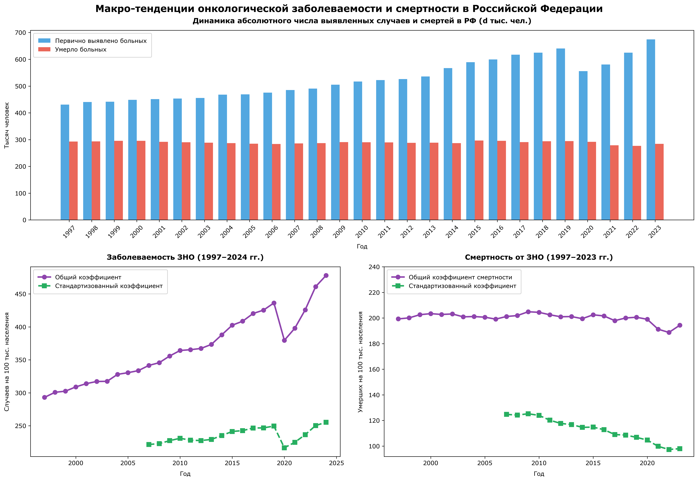
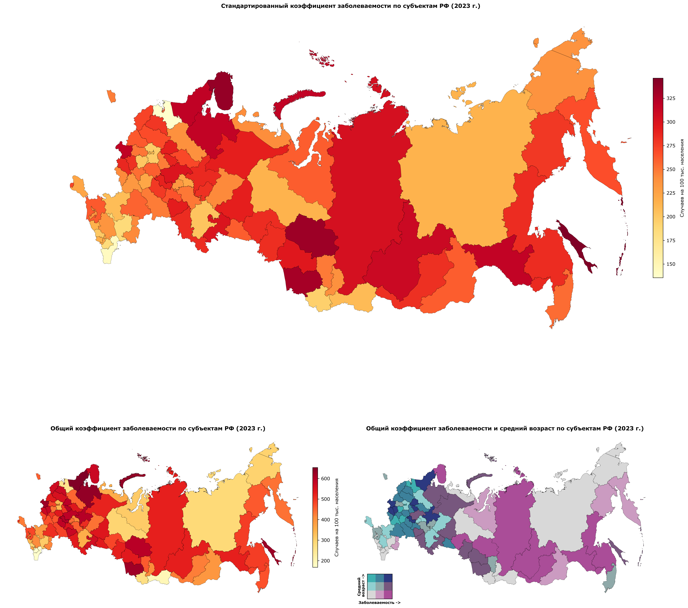

# analysisis-of-oncology-morbidity-in-Russia
Исследование онкологической заболеваемости и смертности в Российской Федерации (1997–2024 гг.)
# Эпидемиологический и пространственный анализ онкологической заболеваемости и смертности в РФ (1997–2023 гг.)

Аналитический проект, посвященный комплексному анализу динамики злокачественных новообразований (ЗНО), оценке влияния половозратсной структуры населения и пространственной дифференциации регионов.

Автор: Киселева Елизавета, 2 курс ФГГТ НИУ ВШЭ
 
---

## Данные и источники

Для проведения исследования сформирована панельная база данных на основе официальной государственной статистики:
1. **Онкологическая статистика (1997–2023 гг.):** Данные ежегодных статистических сборников МНИОИ им. П.А. Герцена (филиал ФГБУ «НМИЦ радиологии» Минздрава России) *«Злокачественные новообразования в России (заболеваемость и смертность)»*. (https://tochno.st/datasets/cancer_incidence)
2. **Демографические показатели:** Аггрегированные данные Федеральной службы государственной статистики (https://tochno.st/datasets/bdmo) по половозрастной структуре, численности и среднему возрасту населения субъектов РФ.
3. **Геопространственные данные:** Векторные слои границ регионов РФ в формате `.geojson` (https://github.com/hairymax/offline_russia_plotly/blob/main/data/russia_regions.geojson?ysclid=mvhbqoyyan311685916)

### Важно!
Для запуска на своем устройстве следует:

1. Скачать ipynb проекта c github
2. Перейти по ссылке https://tochno.st/datasets/cancer_incidence) и скачать csv-архив с данными (oncology_1997_2024)
3. Перейти по ссылке https://tochno.st/datasets/bdmo и скачать сsv-архив из раздела демография (demography_2005_2023)
4. Перейти по ссылке https://github.com/hairymax/offline_russia_plotly/blob/main/data/russia_regions.geojson?ysclid=mvhbqoyyan311685916 и скачать geojson (russia_regions)
5. Все скачанные данные разархивировать в папку data в папке с блокнотом проекта и переименовать так как написано в скобках

---

## Методология и аналитический инструментарий

В ноутбуке реализован полный цикл обработки и анализа эпидемиологических данных с использованием библиотек Python (pandas, geopandas, numpy, matplotlib, seaborn и scipy):

* **Статистический анализ:** Корреляционный анализ Спирмана ($r$) для оценки взаимосвязи заболеваемости со средним возрастом населения.
* **Графический анализ:** Графическая визуализация и последующий анализ графиков при помощи библиотек seaborn и mtplotlib
* **Пространственный анализ:** Построение моно- и бивариантных картограмм (`GeoPandas`) для выявления пространственных кластеров и региональных аномалий.

---

## Ключевые аналитические тезисы и полученные графики


* **Макро-динамика и пандемийный сбой:** В абсолютных числах первичная заболеваемость выросла с 430 тыс. (1997 г.) до 675 тыс. (2023 г.) при стабильном числе смертей (280–300 тыс./год). Провал выявляемости в 2020 г. (~550 тыс.) успешно компенсирован к 2023 г.
* **Демографический фактор:** Рост общего коэффициента заболеваемости (с 295 до >470 на 100 тыс.) на фоне слабого изменения стандартизованного (с 220 до 255) доказательно подтверждает, что основной прирост диагнозов связан со старением населения.
* **Эффективность лечения:** Снижение стандартизованной смертности (с 125 в 2007 г. до <100 в 2023 г.) указывает на реальный прогресс в ранней диагностике и терапии.
* **Географическая и гендерная дифференциация:** Субъекты Сибири, ДФО и Северо-Запада демонстрируют повышенные показатели смертности и индекса MIR, тогда как СКФО сохраняет минимальные значения. Мужчины имеют существенно худший онкологический прогноз (медианный MIR ~0.48 против ~0.30 у женщин) из-за высокой доли агрессивных раков легкого и ЖКТ.

---

## Структура репозитория

```text
.
├── graphs                                   # полученные графики
├── Kiseleva-oncology-russia-project.ipynb   # Основной исследовательский ноутбук с кодом и графиками
├── Kiseleva-oncology-russia-project.md      # Ноутбук в формате md
├── README.md                                # Документация проекта
